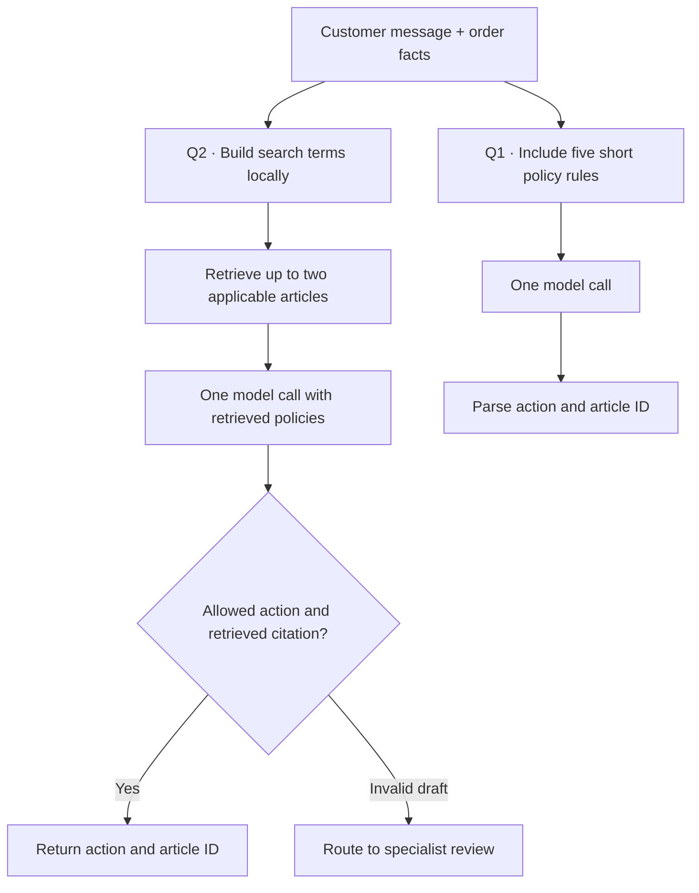

# ShopAssist — support copilot cost lab

A customer asks for a replacement. ShopAssist reads the conversation and order record, selects a support action, and cites the help-center policy behind it. The assignment measures how few model billing points each ticket can use while preserving both the action and the citation.

## One cracked mug, two different outcomes

Both customers reported damage two days after delivery. The order record tells us whether the mug was custom-made.

| Ticket | Order record | Next step | Supporting policy |
|---|---|---|---|
| T-1004 | Standard stock mug | Send a replacement (`REPLACE`) | [Damage within 7 days](data/kb/damage-replacement-7-days.md) |
| T-1003 | Personalized photo mug | Send to a specialist (`ESCALATE_TIER2`) | [Custom item review](data/kb/custom-items-no-replace.md) |

## How the two solutions work



**Q1** already used one call. Shortening the prompt and removing requests for long explanations reduced its bill. **Q2** originally called the model in all four stages. In the revised pipeline, Python handles triage, retrieval and audit. Only the composition stage calls the model.

## Measured results

On ticket **T-1001**, the unopened-headphones refund, both versions returned `REFUND` and `returns-within-30-days`.

| T-1001 | Original points | Revised points | Reduction |
|---|---:|---:|---:|
| Q1 | 8,850 | 1,257 | 85.8% |
| Q2 | 73,416 | 1,248 | 98.3% |

| Across the four public tickets | Total points | Average | Highest | Per-ticket limit |
|---|---:|---:|---:|---:|
| Q1 | 4,638 | 1,159.50 | 1,257 | 3,000 |
| Q2 | 4,581 | 1,145.25 | 1,248 | 2,500 |

**18 tests passed** on the reviewed version. The local simulator determines the outcome from order facts. Tests also inspect the shortlist directly to check whether retrieval supplied the expected policy. The full measurements and limitations are in [WRITEUP.md](WRITEUP.md).

## What a billing point measures

An uncached input token costs **3 points**, a cached input token costs **0.3**, and an output token costs **15**. On Q1 ticket T-1001, the model read 189 tokens and returned 46. The bill was **189 × 3 + 46 × 15 = 1,257 points**. All reported runs used zero cached tokens. The lab's prefix discount requires an identical prefix of at least 1,024 tokens.

## Reproduce the results

From the repository root, run these commands in your Python environment.

```bash
python -m pip install -r requirements.txt
python -m pytest -q
python question1/run.py
python question2/run.py
```

To see the model call and token counts for the two mug examples:

```bash
python scripts/breakdown.py q2 T-1004 T-1003
```

## Explore the code

| Track | Implementation | Assignment |
|---|---|---|
| Q1 | [Single-call agent](question1/agent.py) | [Q1 specification](questions/question-1.md) |
| Q2 | [Four-stage pipeline](question2/agent.py) | [Q2 specification](questions/question-2.md) |

[Ticket messages](data/tickets/) · [Order records](data/orders/) · [Policy articles](data/kb/) · [Billing code](shared/billing.py) · [Boundary and audit tests](tests/test_review.py)

The supplied model client lives in [shared/llm.py](shared/llm.py). The assignment reserves `eval/reference.py` for evaluation and the simulator. Agents must not import it directly.
